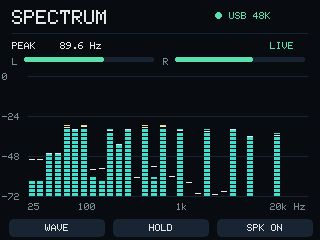
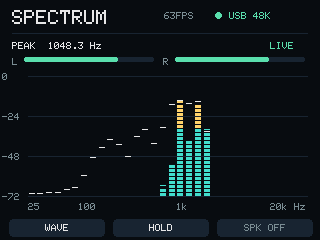

# cores3-usb-spectrum

M5Stack CoreS3を、USBオーディオ入力のスペクトラムアナライザーにするファームウェアです。PCの再生音をUSBで受信し、本体画面に32バンドのスペクトラムを表示します。普段の使用に専用PCアプリや追加ドライバーは不要です。



[v1.1.0をダウンロード](https://github.com/Xenoah/cores3-usb-spectrum/releases/tag/v1.1.0) · [性能測定・実機テスト結果](verification/performance.json)

## 普段の使い方

1. 書き込み済みのCoreS3を、データ通信対応のUSB-CケーブルでPCに接続します。
2. Windowsの音声出力先に **CoreS3 USB Spectrum** を選びます。
3. 音楽などを再生すると、本体画面にスペクトラムが表示されます。

専用PCアプリ、ブラウザー、Python、仮想オーディオドライバーは運用に不要です。Windows標準のUSB Audio 2.0ドライバーを使用します。初回の出力先選択は必要で、再接続時の出力先はWindowsの設定に依存します。

音声の出力先はCoreS3の内蔵モノラルスピーカーです。既存のPCスピーカー／ヘッドホンと同時に鳴らす場合は、PC側で別途音声の振り分けが必要です。

## 機能

- USB Audio Class 2.0、48 kHz / 16 bit / ステレオ入力。
- 4096点Hann窓FFT、25 Hz〜20 kHzの32対数バンド、ピーク保持、左右RMSレベル。
- 左右のパワーを合成し、逆位相のステレオ信号も解析。
- **WAVE / BARS**：左チャンネル波形とスペクトラムを切り替え。
- **HOLD / RESUME**：表示を停止／再開。音声受信は継続。
- **SPK ON / OFF**：本体スピーカーをミュート／解除。解析は継続。
- USB入力が停止すると待機画面を表示。

縦軸は入力のdBFSです。各バンドは含まれるFFTビンの最大値で、帯域全体の積算音圧ではありません。FFTの周波数分解能は約11.72 Hzです。

## 対応ハードウェア

[M5Stack CoreS3](https://docs.m5stack.com/en/core/CoreS3)（ESP32-S3、16 MB Flash、8 MB **Quad** PSRAM）用です。CoreS3搭載スタックチャンで実機確認しています。Core2は対象外です。macOS / LinuxでのUSBオーディオ動作は未検証です。

スタックチャンのサーボ、カメラ、内蔵マイク、Wi-Fiは使用しません。このファームウェア使用中は、従来の会話・表情機能に代わってスペクトラムを表示します。

## ファームウェアの書き込み

初回の書き込み作業にはPythonとesptoolが必要です。通常使用時には不要です。以下はWindowsでの例です。

1. [Releases](https://github.com/Xenoah/cores3-usb-spectrum/releases)から `cores3-usb-spectrum-v1.1.0.zip` をダウンロードして展開します。書き込み用BIN、手順、ライセンスを同梱しています。
2. esptoolを用意します。

   ```powershell
   python -m pip install "esptool==5.2.0"
   ```

3. CoreS3の**RESETを緑LEDが点灯するまで約3秒長押しし、離します**。ダウンロードモードのCOM番号をデバイスマネージャーで確認します。以下の `COM4` は実際の番号に置き換えてください。
4. 元のファームウェアを残す場合は、書き込み前にフラッシュ全体を保存します。

   ```powershell
   python -m esptool --chip esp32s3 --port COM4 --after no-reset read-flash 0 0x1000000 original-backup.bin
   ```

   このバックアップは元の設定を含みます。各自のPCに保管してください。

5. 展開したフォルダーで次を実行します。BINはブートローダー・パーティション表・アプリを結合済みなので、書き込み先は **0x0** です。

   ```powershell
   python -m esptool --chip esp32s3 --port COM4 --after watchdog-reset write-flash 0x0 cores3-usb-spectrum-v1.1.0.bin
   ```

6. 本体が起動したら、Windowsの音声出力先に **CoreS3 USB Spectrum** を選びます。

`SHA256SUMS.txt` と `Get-FileHash .\cores3-usb-spectrum-v1.1.0.bin -Algorithm SHA256` の値でファイルを検証できます。通常動作中とダウンロードモードでCOM番号が変わる場合があります。書き込み後にダウンロードモードへ留まる場合は、RESETを短く押してください。

元に戻すには、再びダウンロードモードにして、自分のバックアップを0x0へ書き戻します。

```powershell
python -m esptool --chip esp32s3 --port COM4 --after watchdog-reset write-flash 0x0 original-backup.bin
```

## ソースからビルド

PlatformIO Core 6.2.0、Espressif32 6.12.0、ESP-IDF 5.5.0でビルドを確認しています。

```powershell
python -m pip install "platformio==6.2.0"
pio run -j 4
```

設定は `sdkconfig.defaults`、依存バージョンは `src/idf_component.yml` と `dependencies.lock` に記録しています。PSRAMは **Quadモード**です。

結合BINの作成例（esptool 5.2.0）：

```powershell
python -m esptool --chip esp32s3 merge-bin --output cores3-usb-spectrum.bin --flash-mode dio --flash-freq 80m --flash-size 16MB 0x0 .pio/build/cores3/bootloader.bin 0x8000 .pio/build/cores3/partitions.bin 0x10000 .pio/build/cores3/firmware.bin
```

### DSPテスト

Visual Studioの「x64 Native Tools Command Prompt」で実行します。

```bat
tools\test_spectrum.cmd
```

GCC / Clangのある環境でも実行できます。

```sh
c++ -std=c++17 -O2 tools/test_spectrum.cpp -o /tmp/test_spectrum
/tmp/test_spectrum
```

### 開発用の実機診断

TinyUSBのUAC2とCDCを複合デバイスにしています。CDCは診断専用で、通常使用時に開く必要はありません。

```powershell
python -m pip install pyserial Pillow
python tools/device.py status
python tools/device.py screenshot --output screen.png
python tools/test_device.py
python tools/benchmark_device.py --output verification/performance.json
python tools/device.py verify-display
python tools/test_display.py
```

`test_device.py` はWindows標準のwaveOut APIで対象装置へテスト音を送ります。システムの既定出力先は変更しません。診断用COMには `s`（状態）、`p`（PPM画像）、`m`（ミュート切り替え）、`h`（保持切り替え）、`w`（波形切り替え）、`v`（LCDの読み戻し検証）を送れます。

### v1.1.0の画面更新の最適化

接続したCoreS3での実測値です。動くステレオ信号を8秒間送ったときの平均更新回数を比較しています。測定には `1.1.0-dev` を使用し、正式版 `1.1.0` は診断用バージョン文字列だけを変更して再ビルドしています。正式版BINの再書き込みによる実機試験は行っていません。

| 表示 | v1.0.0 | 最適化版 1.1.0-dev |
| --- | ---: | ---: |
| スペクトラム | 15.34回/秒 | **134.58回/秒（8.77倍）** |
| 波形 | 未測定 | **112.14回/秒** |

両モードで音声キューの欠落は0バイトでした。LCD RAMの読み戻しは計6回・各76,800画素で不一致0（色変換の最大差3/255）。周波数・振幅校正・逆位相・無音・HOLD解除後の待機復帰も確認しています。[測定条件と結果](verification/performance.json)



固定の33ms待ちを廃止し、新しい音声データに追従して解析・描画します。待機中やHOLD中は不要なFFT・画面転送を省きます。

- ESP-IDFを速度優先の `-O2` でビルドし、ESP-DSP 1.8.2のESP32-S3向けRadix-4 FFTを使用。
- FFTのサイズは4096点、音声入力は48 kHz / 16 bit / ステレオのままです。
- LCDへは変化した棒・ピーク・数値・メーターだけを転送。波形は前回と今回の振幅が占める範囲に絞ります。内部RAMの2つのDMAバッファでPSRAMからのコピーとSPI転送を重ねます。
- ピーク保持と減衰は経過時間で計算し、FPSの変動による速さの変化を防ぎます。
- CPUは240 MHz、LCDのSPIはM5GFX標準の40 MHzで動作します。

画面のFPSは「LCDへの転送が完了した表示更新」の秒間回数です。液晶パネル自体の走査周波数を測定した値ではありません。静止画面のFPSは低下します。`status` には解析時間・描画時間・LCD転送時間・転送バイト数も表示します。

`benchmark_device.py` は音量と周波数が動くステレオ信号を送り、8秒間の更新回数と音声欠落を測定します。本体スピーカーを一時ミュートし、終了時に元の状態へ戻します。`verify-display` は描画用バッファとLCD RAMを比較します（RGB565/666変換の誤差を許容）。

## v1.0.0の実機確認（2026-10-13）

- Microsoft標準 `usbaudio2.inf` / `usbser.inf` で認識。
- USBから送った440 Hz、1 kHz、4 kHz、逆位相の1 kHz、無音の試験に合格。
- 試験中のスピーカーキュー欠落は0バイト。
- 再起動後のUSB再認識を確認。
- [測定結果](verification/summary.json)と、[入力時](verification/spectrum-live.png)・[待機時](verification/spectrum-idle.png)の実機フレームバッファを収録。

画面は実機の描画データで確認しています。物理タッチ操作、実際のスピーカー音の聴感、ケーブルの抜き差しは独立した実測を行っていません。

## ライセンス・クレジット

本プロジェクトのコードは[MIT License](LICENSE)です。ファームウェアに含まれる依存ソフトウェアのライセンスと著作権表示は [THIRD_PARTY_NOTICES.txt](THIRD_PARTY_NOTICES.txt) を参照してください。M5Stack公式プロジェクトではありません。

USB VID/PIDはEspressifのサンプル値（303A:8000）を使った試作です。製品用に独自のVID/PIDを割り当てたものではありません。

## 公式資料

- [CoreS3の仕様とダウンロードモード](https://docs.m5stack.com/en/core/CoreS3)
- [Espressif USB Device UAC](https://docs.espressif.com/projects/esp-iot-solution/en/latest/usb/usb_device/usb_device_uac.html)
- [Windows標準USB Audio 2.0ドライバー](https://learn.microsoft.com/en-us/windows-hardware/drivers/audio/usb-2-0-audio-drivers)
